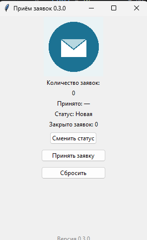

# Программа для принятия заявок версия 0.2.0-0.3.0
## Запуск программы
Что бы запустить приложение:
1. зайдите в общую папку: 25.11.2026-main
2. Нажмите кнопку:
или введите в терминале ` py app_v03_для_тестирования.py `

3. Можно начинать работу

## Возможности приложения
- Можно принимать заявки
- отмечать их статус
- сбрасывать счётчик принятых заявок
- следить за временем принятия заявки

## Оформление приложения

